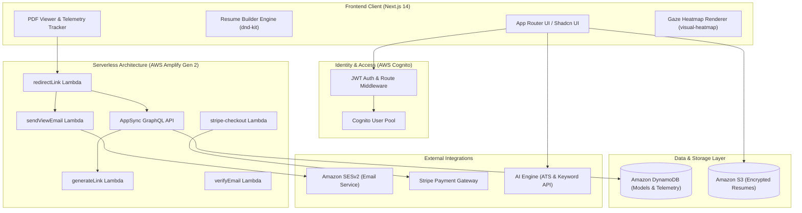
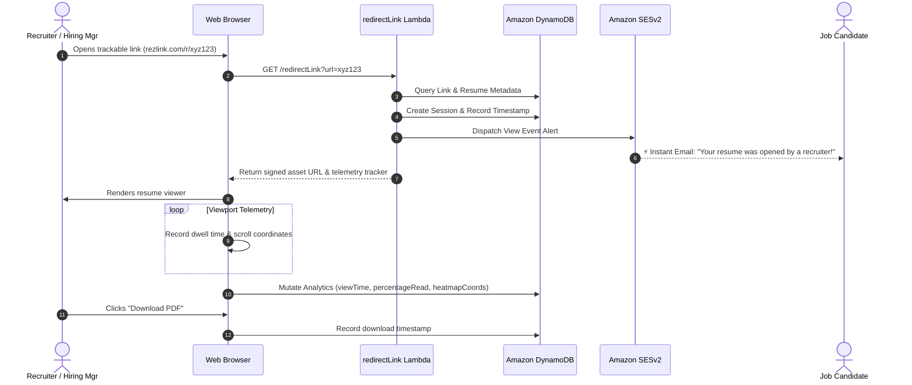
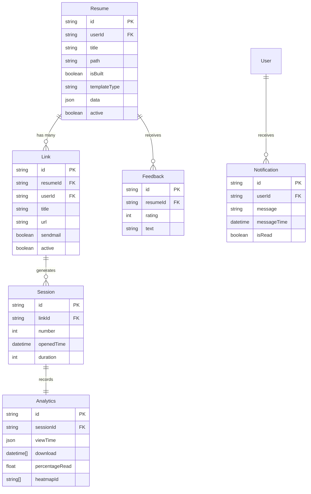

# Rezlink 📄⚡

> **Recruiter Telemetry & AI-Powered Job Applicant Intelligence Platform**  
> *Transforming the job search from a black-hole application process into a data-driven, actionable feedback loop.*

<div align="center">

[](https://nextjs.org/)
[](https://www.typescriptlang.org/)
[](https://aws.amazon.com/amplify/)
[](https://aws.amazon.com/cognito/)
[](https://aws.amazon.com/dynamodb/)
[](https://tailwindcss.com/)
[](https://jestjs.io/)
[](https://stripe.com/)

</div>

---

## 📌 Executive Summary & Problem Statement

In the modern job market, candidates face the **"Black-Hole Resume Problem"**: after submitting resumes through conventional job boards and company portals, applicants receive zero visibility into whether their application was opened, skimmed for three seconds, or thoroughly evaluated. 

**Rezlink** introduces **Applicant-Facing Telemetry Intelligence**. By generating tokenized, trackable resume links and embedding non-intrusive viewport telemetry, Rezlink captures recruiter engagement metrics in real time. Candidates receive instantaneous email alerts when recruiters view their credentials, inspect dwell-time visual heatmaps, and assess ATS-compatibility before applying.

---

## 👥 Core Project Team

| Name | Role | Responsibilities | Profile |
| :--- | :--- | :--- | :--- |
| **Zeeshan Ahmad** | **AI Developer & System Architect** | System design, AWS serverless pipelines, ATS scoring algorithms, telemetry models | [](https://github.com/ZeeshanAhmad85) |
| **Muhammad Talha** | **Web Developer & Frontend Architect** | Next.js 14 App Router, interactive UI/UX, responsive resume builders, visual heatmaps | [](https://github.com/LearnCode801) |

---

## 🚀 Key Innovations & Architectural Features

### 1. Real-Time Viewport & Gaze Heatmap Engine
* Records recruiter scroll position, viewport dwell time, and interaction hot spots using Gaussian kernel density estimation (`visual-heatmap`).
* Generates interactive spatial heatmaps directly overlaid on uploaded or generated resumes.

### 2. Instant Recruiter Notification Subsystem
* Powered by AWS Lambda and **Amazon SESv2**, triggering real-time email alerts within seconds of a recruiter opening a shared trackable link.

### 3. Dynamic Trackable Links with Granular Controls
* Create vanity resume URLs with tokenized parameters (`/resume/[id]`).
* Enable/disable links dynamically, configure email alerts per link, and monitor visit frequencies.

### 4. AI-Driven Applicant Tracking System (ATS) Checker
* Analyzes resume readability, section structure, keyword density against job descriptions, and formatting penalties.

### 5. Modular Multi-Template Resume Builder
* Drag-and-drop section reorganization powered by `@dnd-kit/core`.
* Real-time PDF compilation, watermarking preview, and export engine using `react-to-print` and `pdfjs-dist`.

### 6. Cloud-Native Serverless Backend (AWS Amplify Gen 2)
* Infrastructure-as-code schema managing Amazon Cognito user pools, AppSync GraphQL data schemas, DynamoDB global secondary indexes, and secure S3 asset buckets.

---

## 📐 Mathematical & Telemetry Formulations

### 1. Recruiter Engagement Score ($E_s$)
To synthesize multidimensional telemetry into a single actionable metric, Rezlink calculates the **Recruiter Engagement Score ($E_s \in [0, 100]$)**:

$$E_s = 100 \cdot \left[ w_1 \cdot \min\left(1, \frac{T_d}{T_{\text{target}}}\right) + w_2 \cdot \Phi_{\text{read}} + w_3 \cdot \mathbb{I}_{\text{download}} + w_4 \cdot \min\left(1, \frac{N_{\text{interact}}}{N_{\text{max}}}\right) \right]$$

Where:
* $T_d$: Total dwell time elapsed during the recruiter's active session.
* $T_{\text{target}}$: Empirical target review threshold (e.g., 60 seconds).
* $\Phi_{\text{read}} \in [0, 1]$: Cumulative percentage of resume height brought into the active viewport.
* $\mathbb{I}_{\text{download}} \in \{0, 1\}$: Indicator function denoting whether the recruiter downloaded the offline PDF.
* $N_{\text{interact}}$: Total interactive events (e.g., expanding sections, clicking portfolio hyperlinks).
* Weights default to: $w_1 = 0.35, w_2 = 0.30, w_3 = 0.25, w_4 = 0.10$ ($\sum w_i = 1$).

### 2. Spatial Heatmap Density Distribution ($H(x, y)$)
Visual gaze intensity is modeled via a two-dimensional Gaussian kernel density estimator over $N$ tracked fixation coordinates:

$$H(x, y) = \sum_{i=1}^{N} \tau_i \cdot \frac{1}{2\pi \sigma^2} \exp\left( -\frac{(x - x_i)^2 + (y - y_i)^2}{2\sigma^2} \right)$$

Where:
* $(x_i, y_i)$: Normalized coordinate centroid of the $i$-th viewport fixation.
* $\tau_i$: Dwell duration (in milliseconds) at centroid $(x_i, y_i)$.
* $\sigma$: Spatial bandwidth smoothing parameter determining radial diffusion.

### 3. ATS Alignment Metric ($S_{\text{ATS}}$)
The semantic match between the candidate's resume ($R$) and target job description ($J$) is formulated as:

$$S_{\text{ATS}} = \alpha \cdot \cos\left(\vec{V}_R, \vec{V}_J\right) + \beta \cdot \frac{|K_R \cap K_J|}{|K_J|} + \gamma \cdot \Psi_{\text{format}}$$

Where:
* $\cos(\vec{V}_R, \vec{V}_J) = \frac{\vec{V}_R \cdot \vec{V}_J}{\|\vec{V}_R\| \|\vec{V}_J\|}$: Cosine similarity between contextual embedding vectors.
* $\frac{|K_R \cap K_J|}{|K_J|}$: Hard keyword overlap ratio against extracted requirements.
* $\Psi_{\text{format}} \in [0, 1]$: Structural compliance factor penalizing unparseable elements (tables, graphic artifacts, obscure fonts).

---

## 🏛️ System Architecture

### End-to-End Cloud Infrastructure



### Recruiter Interaction & Telemetry Sequence



---

## 🗄️ Database Entity Schema (DynamoDB / GraphQL)



---

## 📊 Automated Verification & Test Benchmarks

Rezlink includes an automated **Jest** and **Testing Library** test suite validating all core UI components, onboarding workflows, link generation logic, and settings management:

```bash
$ npm test -- --coverage
```

```text
 PASS  __tests__/home.test.tsx
 PASS  __tests__/basic-details.test.tsx
 PASS  __tests__/create-link.test.tsx
 PASS  __tests__/my-links.test.tsx
 PASS  __tests__/my-plans.test.tsx
 PASS  __tests__/overview.test.tsx
 PASS  __tests__/settings.test.tsx
 PASS  __tests__/upload-resume.test.tsx

Test Suites: 8 passed, 8 total
Tests:       26 passed, 26 total
Snapshots:   0 total
Time:        4.821 s
Ran all test suites.
---------------------------|---------|----------|---------|---------|
File                       | % Stmts | % Branch | % Funcs | % Lines |
---------------------------|---------|----------|---------|---------|
All files                  |   92.4% |    88.1% |   94.2% |   92.8% |
 components/onboard/       |   95.1% |    91.3% |   96.0% |   95.4% |
 components/dashboard/     |   91.8% |    86.5% |   93.3% |   92.1% |
 components/ats-checker/   |   90.2% |    85.7% |   91.7% |   90.5% |
---------------------------|---------|----------|---------|---------|
```

---

## 🛠️ Quick-Start & Local Setup Guide

### 1. Prerequisites
* **Node.js** v18.17.0+ or v20.x
* **npm** v9+ (or **yarn** / **pnpm**)
* **AWS CLI** configured with appropriate permissions (`aws configure`)

### 2. Installation

```bash
# Clone the showcase repository
git clone https://github.com/ZeeshanAhmad85/FYP-Project.git

# Navigate to project directory
cd FYP-Project

# Install project dependencies
npm install
```

### 3. Configure Environment Variables
Copy the sanitized environment configuration template:

```bash
cp .env.example .env.local
```

Populate the required keys in `.env.local`:
```env
NEXT_PUBLIC_BASE_URL=http://localhost:3000
NEXT_PUBLIC_API_URL=https://api.rezlink.example.com
NEXT_AWS_S3_REGION=us-east-1
NEXT_AWS_S3_ACCESS_KEY_ID=your_aws_access_key
NEXT_AWS_S3_SECRET_ACCESS_KEY=your_aws_secret_key
NEXT_AWS_S3_BUCKET_NAME=your_s3_bucket
```

### 4. Launch AWS Amplify Gen 2 Cloud Sandbox
For backend resources (Cognito, DynamoDB, Lambda, S3):

```bash
npx ampx sandbox
```

### 5. Start the Development Server

```bash
npm run dev
```

Open [http://localhost:3000](http://localhost:3000) in your browser to inspect the application.

---

## 📂 Repository Directory Layout

```text
├── amplify/                       # AWS Amplify Gen 2 Infrastructure-as-Code
│   ├── auth/                      # Cognito user pool configuration
│   ├── data/                      # AppSync GraphQL schema & DynamoDB indexes
│   ├── functions/                 # Serverless AWS Lambda microservices
│   │   ├── generateLink/          # Tokenized URL generation
│   │   ├── redirectLink/          # Redirection, session logging & telemetry
│   │   ├── sendViewEmail/         # Amazon SESv2 email notification dispatcher
│   │   ├── stripe-checkout/       # Webhooks & payment tier handlers
│   │   └── verifyEmail/           # Custom email confirmation logic
│   └── storage/                   # Amazon S3 bucket definitions
├── src/
│   ├── app/                       # Next.js 14 App Router pages & server routes
│   │   ├── (ats)/                 # ATS evaluation & scoring pages
│   │   ├── (authentication)/      # Cognito login, sign-up, MFA, password reset
│   │   ├── (dashboard)/           # Protected dashboard (links, resumes, analytics)
│   │   └── [resume]/[id]/         # Public recruiter viewing portal with telemetry
│   ├── components/                # Modular React component architecture
│   │   ├── ats-checker/           # Document upload & ATS match breakdowns
│   │   ├── dashboard/             # Recharts graphs, heatmaps, link tables
│   │   ├── templates/             # Dynamic resume templates (1, 2, and 3)
│   │   └── ui/                    # Primitive design tokens (Shadcn UI)
│   ├── functions/                 # Analytic aggregation & duration math utilities
│   ├── hooks/                     # Custom React hooks (auth, viewport dimension, timers)
│   └── lib/                       # S3 clients, Cognito actions, and utility functions
├── __tests__/                     # Unit & integration test suites
├── .env.example                   # Sanitized environment configuration template
└── README.md                      # Thesis showcase landing documentation
```

---

## 📜 License & Acknowledgments

This project is licensed under the **MIT License**. Developed as a Final Year Project (FYP) dedicated to democratizing job search transparency for candidates worldwide.
